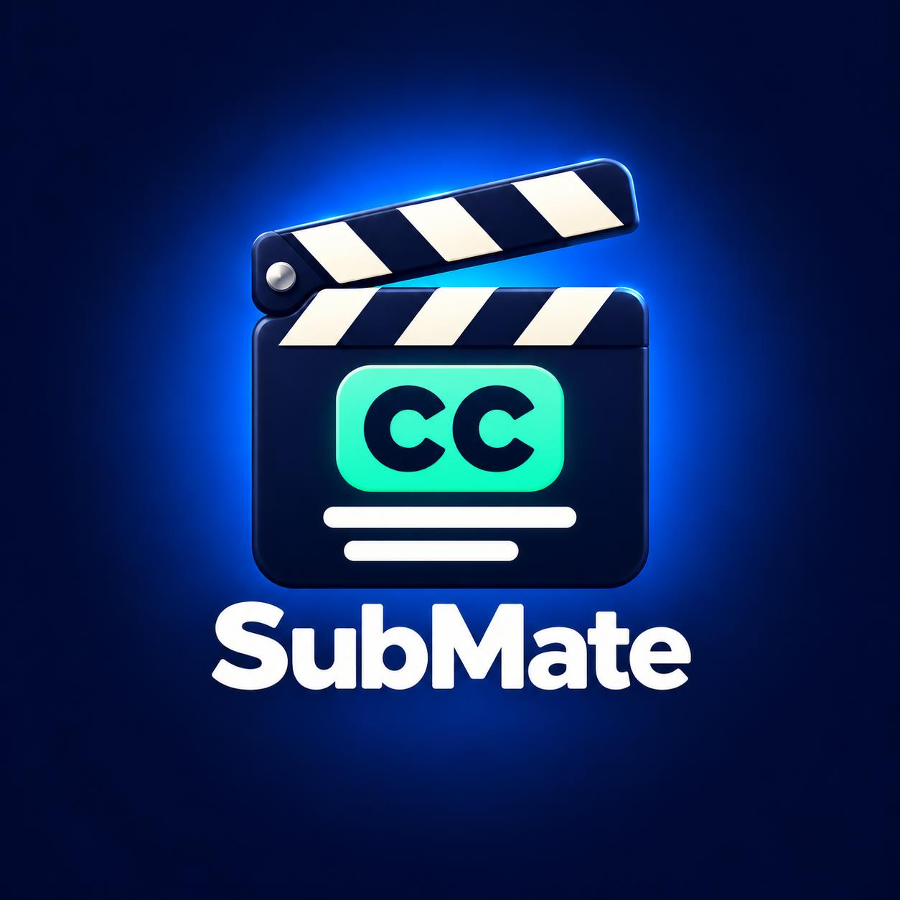
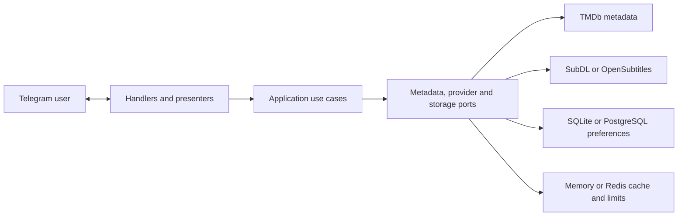

# SubMate

**Movie and TV subtitles, delivered in Telegram.**

Find a title, choose a subtitle language, and receive a validated SRT file.
For series, select the season and episode before choosing a subtitle version.
SubMate supports English and Persian interfaces, remembers language preferences,
and provides recovery actions when a download fails.

[](https://github.com/shakibasaee/submate-bot/actions/workflows/quality.yml)

[Open @Sub_Mate_bot](https://t.me/Sub_Mate_bot) ·
[Setup](#quick-start) · [Troubleshooting](#troubleshooting) ·
[Verification](#verification) · [Architecture](#architecture)

> The bot needs a running host and access to Telegram, TMDb, and its subtitle
> provider. Opening its profile does not start a conversation; press **Start** or
> send `/start`. A local installation stops when its computer is off or asleep.

## What you can do

- Search movies and series using TMDb titles and release years.
- Get close-match suggestions on some misspellings. When the first search returns
  nothing, SubMate tries one shorter prefix and shows only similar TMDb titles.
- Navigate titles, seasons, episodes, and subtitle versions with inline buttons,
  Back controls, and pagination.
- Choose **English** or **فارسی** for the interface independently of subtitle language.
- Review available release names, language, format, hearing-impaired and forced
  flags, and provider-supplied ratings or download counts. Missing metadata is omitted.
- Receive SRT documents with movie-year or `SxxExx` identifiers in their filenames.
- Retry temporary failures, choose another version, change language, or start a
  new search without repeating `/start`.

The persistent menu contains **Subtitle search**, **Subtitle language**,
**Settings**, and **Help**. First use offers an interface-language picker, followed
by a personalized welcome. Later `/start` messages use the saved interface language.

## Verification status

This README describes the implementation on **`codex/tmdb-setup-docs`**. It has not
been merged into `main`; the badge above reports the workflow on `main`.
The following are recorded observations, not a live uptime indicator.

| Area | Last recorded evidence |
| --- | --- |
| Automated checks | **220 tests passed**, plus dependency, lint, formatting, and type checks on Python 3.13; recorded 2026-11-06. |
| Live provider downloads | Inception (2010) and Breaking Bad S01E01 SRTs downloaded from SubDL and validated in memory on 2026-10-28. |
| Later connectivity check | Telegram and TMDb connection attempts failed on 2026-10-29. This did not establish invalid credentials. |
| Title suggestions and season ZIP | Automated tests cover close matches, complete and incomplete packs, repeated clicks, and ambiguous uploads. The 2026-11-05 live attempt could not reach Telegram or complete TMDb verification; no live ZIP delivery was verified. |
| Telegram document receipt | Not verified. Provider downloads and mocked uploads do not prove receipt in Telegram. |
| PostgreSQL, Redis, and deployment | Automated coverage/configuration checks exist; live operation in a deployed environment remains unverified. |

See [the integration checklist](INTEGRATION_CHECKLIST.md) for dated observations
and acceptance criteria. No permanent availability is claimed.

## Quick start

### 1. Install

You need Python **3.12+** (the recorded checks used 3.13), a Telegram bot token,
a TMDb **v3 API key**, and credentials for one subtitle provider.
PostgreSQL and Redis are optional for local use.

Clone the branch described by this README:

```bash
git clone --branch codex/tmdb-setup-docs https://github.com/shakibasaee/submate-bot.git
cd submate-bot
```

**Windows PowerShell** — activation is not required:

```powershell
py -3.13 -m venv .venv
.\.venv\Scripts\python.exe -m pip install -r requirements.lock
.\.venv\Scripts\python.exe -m pip install --no-deps -e .
if (-not (Test-Path -LiteralPath .env)) { Copy-Item .env.example .env }
```

**Linux or macOS:**

```bash
python3 -m venv .venv
source .venv/bin/activate
python -m pip install -r requirements.lock
python -m pip install --no-deps -e .
test -f .env || cp .env.example .env
```

Keep an existing `.env`; copying the template must not replace your credentials.
The lock file includes the development tools used by CI.

### 2. Configure

Edit the ignored local `.env`. For a local setup using SubDL:

```dotenv
TELEGRAM_BOT_TOKEN=replace-with-your-bot-token
TMDB_API_KEY=replace-with-your-tmdb-v3-api-key
SUBDL_API_KEY=replace-with-your-subdl-api-key
DEMO_MODE=false
PREFERENCE_SQLITE_PATH=data/preferences.sqlite3
HEALTH_HOST=127.0.0.1
HEALTH_PORT=8080
```

Obtain the bot token from [@BotFather](https://t.me/BotFather), the TMDb key from
[TMDb API settings](https://www.themoviedb.org/settings/api), and a SubDL key from
[your SubDL API panel](https://subdl.com/panel/api).
Use TMDb's **API Key (v3 auth)**, not the longer API Read Access Token.

**Remove or comment out `DATABASE_URL` and `REDIS_URL` from the copied example
unless you intend to run those services.** The SQLite setting above preserves
both language preferences across local restarts.

To use OpenSubtitles instead, leave `SUBDL_API_KEY` unset and configure:

```dotenv
OPENSUBTITLES_API_KEY=replace-with-your-opensubtitles-api-key
OPENSUBTITLES_USERNAME=replace-with-your-opensubtitles-username
OPENSUBTITLES_PASSWORD=replace-with-your-opensubtitles-password
```

Provider selection is explicit: demo mode takes precedence, then a configured
SubDL key, then OpenSubtitles. SubDL does not require the OpenSubtitles credentials.
There is no automatic failover between real providers. Account access, available
subtitles, and download quotas depend on the chosen provider.

### 3. Start one instance

On Windows, double-click **[Start SubMate.cmd](Start%20SubMate.cmd)**. It uses the
existing virtual environment, checks for an existing local instance, and starts
SubMate in the background. You can close the launcher window afterward.

For foreground operation:

```powershell
# Windows, from the repository directory
.\.venv\Scripts\python.exe -m app.main
```

```bash
# Linux/macOS, with the virtual environment activated
python -m app.main
```

Use one method at a time. The local token lock prevents duplicate instances on the
same computer; it cannot detect another host running the same bot.

### 4. Try the user journey

1. Send `/start` to your configured bot and choose the interface language.
2. Choose **Subtitle search**, select a subtitle language if needed, and enter a title.
3. Choose the correct title and year. For TV, choose a season and episode.
4. Select a subtitle version and open the delivered `.srt` document.
5. Use **Another subtitle**, **Change language**, **Choose another episode** for TV,
   or **New search** to continue.

### Download a whole season

With SubDL configured, select a series and season, then choose **Download season
ZIP** on the episode screen. SubMate requires one provider pack that covers every
episode listed by TMDb in the selected subtitle language. It downloads and validates
the individual SRTs, then builds a new ZIP with filenames such as `S01E02-en.srt`.
It never extracts or forwards the provider's archive.

The option is available for seasons of up to 20 episodes (or the configured
global download limit, if lower). Each file counts toward the shared download
limit and provider usage; the bot allows two pack attempts per user per ten
minutes and caps the combined SRT content at 8 MiB. If coverage is incomplete or a
download fails, SubMate keeps the episode list available and sends no partial ZIP.
Whole-series bundles, demo packs, and OpenSubtitles packs are not supported.

After the ZIP arrives, use the buttons immediately below it to return to
episodes or seasons, change subtitle language, or start another search.

## Navigation and recovery

Selections appear below the current message. Where Telegram permits editing,
processing, results, and errors update that panel rather than adding status messages.
The SRT arrives as a separate document.

| Situation | Available recovery |
| --- | --- |
| Temporary provider failure | Retry, return to retained subtitle choices, change language, or start a new search. |
| Invalid or unsafe file | The candidate is excluded from the current flow; choose another version or change language, episode, or title. |
| Uncertain Telegram upload | Check the chat, then choose **I received the file** or explicitly authorize **Not received — send again**. A new search is also available. |
| Successful delivery | Another subtitle, Change language, another episode for TV, or New search. |
| Stale or repeated button | A brief notice; the old action cannot replace the current selection or start a duplicate delivery. |

Back navigation retains the relevant title, language, episode, and cached choices.
Changing subtitle language opens its picker directly. **Settings** changes only the
interface language and preserves the active subtitle selection.

Rejected candidates remain excluded during the current conversation flow, including
when returning to the same episode. A new search, expiry, or restart clears that
exclusion. Uncertain uploads require a receipt decision before another upload of the
same selection; the bot does not silently resend after a timeout.

### Commands

| Command | Action |
| --- | --- |
| `/start` | First-use interface selection, or personalized welcome and main menu. |
| `/search` | Start a new subtitle search. |
| `/language` | Choose or change subtitle language. |
| `/settings` | Change interface language. |
| `/cancel` | End the current workflow while retaining language preferences. |
| `/help` | Usage and commands. |
| `/about` | Project introduction and supported features. |
| `/privacy` | Data use, provider attribution, and copyright notice. |

## Troubleshooting

| Symptom | What to check |
| --- | --- |
| `/start` receives no reply | Confirm the process is running, then check network access to Telegram. Opening a bot profile alone does not send `/start`. |
| Local process is running but the bot is silent | Check the computer's network/VPN access to Telegram and TMDb. A browser-only proxy does not route the Python process. Run the live check below. |
| Subtitle search is not configured | Enter `SUBDL_API_KEY`, or all three OpenSubtitles settings, in the local `.env`; restart to load configuration changes. |
| Authentication is rejected | Verify the relevant provider credentials locally. Network timeouts alone are not evidence of an invalid key. |
| Download quota is exhausted | Wait for the provider's allowance to reset; repeated retries do not restore quota. |
| Port is already in use | Set `HEALTH_PORT` to an unused local port. Do not stop unrelated services. |
| Language preferences disappear after restart | Configure `PREFERENCE_SQLITE_PATH` or PostgreSQL; memory-only preferences do not survive restart. |
| Polling conflict | Ensure only one host/process uses the token. A local lock cannot prevent a remote instance. |

Check the Windows instance from the repository directory:

```powershell
.\.venv\Scripts\python.exe -m scripts.local_bot status
```

The background launcher writes to ignored `logs/submate-local.log`. At startup,
Telegram connection failures are retried in batches of three requests, each with a
20-second timeout, followed by a 15-second pause before the next batch. Invalid
credentials are not retried. Once polling begins, temporary failures use bounded
reconnection backoff. This recovers network interruptions while the process stays
alive; it is not automatic restart after a crash or computer reboot.

**When the computer is off or asleep, the local bot is unavailable.** Running
independently of that computer requires an always-on host and verified deployment.
Pushing code to GitHub does not run it. Container configuration and deployment
procedures are in [DEPLOYMENT.md](DEPLOYMENT.md).

## Verification

Use the virtual environment for all checks. On Windows, replace `python` below
with `.\.venv\Scripts\python.exe` if the environment is not activated.

```bash
python -m scripts.production_smoke
python -m scripts.live_check
```

| Check | Establishes | Does not establish |
| --- | --- | --- |
| `production_smoke` | Runtime dependency health, required configuration, and Telegram authentication. | Live subtitle search, file download, or Telegram receipt. |
| `live_check` | Telegram target/webhook status, TMDb search, and configured-provider movie/episode SRT downloads in memory when reachable. | Telegram document receipt or permanent availability. |
| Manual Telegram acceptance | The selected document arrived, opens correctly, and the conversation remains usable. | Availability after the host stops or across untested deployments. |

The live download check consumes provider quota. Read its reported status categories;
a completed command is not sufficient evidence that every check passed.

For repeatable acceptance:

- **Welcome:** `/start` shows the chosen interface; changing it leaves subtitle language unchanged.
- **Movie:** find **Inception (2010)** and receive an SRT that opens correctly.
- **Episode:** find **Breaking Bad → Season 1 → Episode 1** and receive an SRT with the correct `S01E01` filename.
- **Recovery:** return to versions or change language without losing the title; temporary failures offer Retry and invalid files offer alternatives.
- **Continuation:** begin another search without sending `/start` again.

Record observations in [INTEGRATION_CHECKLIST.md](INTEGRATION_CHECKLIST.md), keeping
provider downloads, Telegram receipt, database behavior, and deployment separate.

### Demo mode

For controlled flow testing, set `DEMO_MODE=true` in the local `.env` and restart.
Telegram and TMDb still require working configuration/connectivity. Samples are
labelled **DEMO**, contain original example captions, and are not real movie dialogue.
Use the fails-once sample to exercise Retry. Production smoke rejects demo mode;
set `DEMO_MODE=false` and restart before testing real subtitles.

## Architecture

SubMate is an asynchronous Python application built with aiogram and aiohttp.
Application use cases depend on ports; Telegram, metadata, providers, and storage
implement the surrounding adapters. The composition root owns shared resources
and shutdown.



| Path | Responsibility |
| --- | --- |
| [`app/domain/`](app/domain/) | Media references, language codes, subtitles, and normalized errors. |
| [`app/application/`](app/application/) | Search, navigation, delivery, recovery, and ports. |
| [`app/bot/`](app/bot/) | Telegram handlers, localization, keyboards, and presenters. |
| [`app/infrastructure/`](app/infrastructure/) | Provider, metadata, persistence, cache, and rate-limit adapters. |
| [`app/bootstrap.py`](app/bootstrap.py) | Dependency construction and shared resource ownership. |
| [`app/core/`](app/core/) | Configuration, redaction, retries, polling lock, health, and metrics. |
| [`scripts/`](scripts/) | Local launcher, runtime smoke check, and live verification. |
| [`tests/`](tests/) | Workflow, provider, navigation, privacy, concurrency, and lifecycle tests. |

See [ARCHITECTURE.md](ARCHITECTURE.md) for dependency rules.

### Configuration and persistence

[`.env.example`](.env.example) lists service, cache, rate-limit, and runtime settings;
[`Settings`](app/core/config.py) defines defaults and validation. Settings load from
`.env` in the working directory; process environment variables take precedence.

- **Preferences:** PostgreSQL takes precedence when configured. Otherwise,
  `PREFERENCE_SQLITE_PATH` enables SQLite; without either, preferences use memory.
- **Conversation state:** process-local memory, expiring lazily after 30 minutes.
  Active selections do not survive restart; use `/start` to begin again.
- **Cache and limits:** Redis when available, otherwise process-local memory.
- **Startup fallback:** unavailable configured PostgreSQL/Redis services fall back
  to memory. Writes made during a preference-store outage are not replayed; restart
  after restoring the service to reconnect. Redis does not make multiple replicas safe.

### Health and operation

| Endpoint | Meaning |
| --- | --- |
| `GET /health/live` | The local HTTP listener and process respond. |
| `GET /health/ready` | Runtime dependency health and provider configuration; not live provider authentication or delivery. |
| `GET /metrics` | Aggregate process and bot counters in Prometheus-compatible format. |

Keep these endpoints private. Local health may respond while startup is waiting
for Telegram connectivity. [`compose.yaml`](compose.yaml) includes PostgreSQL,
Redis, persistent database volumes, and a container restart policy; those files
are deployment configuration, not evidence of a deployed service.

## Development

Run the CI-equivalent checks in the virtual environment:

```bash
python -m pip check
python -m ruff check .
python -m ruff format --check .
python -m pyright
python -m pytest --cov=app --cov-report=term-missing --cov-report=xml
```

On Windows, if the system temporary directory is inaccessible, add
`--basetemp=tmp/pytest` to the test command. The repository ignores this directory.
The [Quality workflow](.github/workflows/quality.yml) runs on pull requests and
pushes to `main`. Automated tests use controlled Telegram/provider responses and
must not be reported as proof of live delivery.

## Limitations and privacy

- English and Persian are the selectable interface and subtitle languages.
- TV Specials (Season 0) are excluded. Availability depends on the provider.
- SRT content must pass structural and safety checks and stay within **2 MiB**.
  Incoming archives, unsupported content, unsafe control characters/markup, and undecodable
  files are rejected. Validation does not guarantee timing alignment or translation quality.
- Subtitles are processed in memory, not saved by the download pipeline. Raw SubDL
  SRT entries must match the requested language and episode; uncertain identities
  and unsafe download destinations are rejected.
- Single-instance polling and conversation state are process-local. There is no
  cross-restart exactly-once delivery guarantee, synchronization, or automatic
  provider failover.
- Preference stores retain Telegram user IDs and separate language choices.
  Display names are used for the welcome and are not stored. Searches go to TMDb;
  results may be cached temporarily. There is no search-history table or added analytics.
- Logs redact recognized credentials, identifiers, and download URLs. Keep `.env`,
  logs, databases, and downloaded subtitle files out of Git.

Subtitles belong to their authors. Provider and uploader attribution are included
when available. Review [SECURITY.md](SECURITY.md) for operator responsibilities and
[DEPLOYMENT.md](DEPLOYMENT.md) before operating an externally hosted instance.
