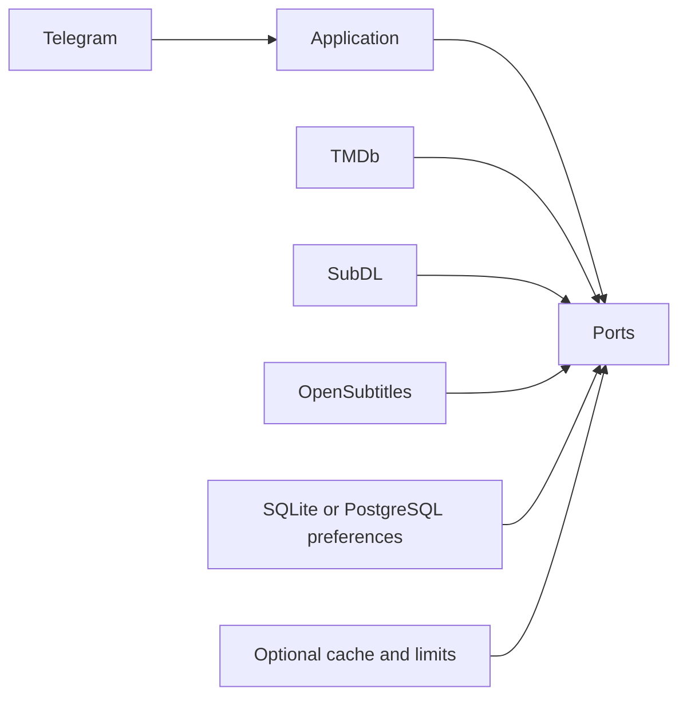

# SubMate

[](https://github.com/shakibasaee/submate-bot/actions/workflows/quality.yml)

SubMate is a Telegram bot that finds movie and TV subtitles and delivers them
directly in chat. It uses TMDb to identify the exact title or episode, searches
SubDL or OpenSubtitles for English or Persian subtitles, and sends the selected result as
a validated SRT document.

The application is a typed, asynchronous Python service with explicit domain,
application, Telegram, and infrastructure boundaries. It can run as a lightweight
single process for local use or with PostgreSQL and Redis for a more durable
deployment.

## Demo and verified status

Movie: /start -> interface language on first use -> Subtitle search -> subtitle language -> Inception (2010) -> subtitle -> SRT.
TV: search Breaking Bad -> Season 1 -> Episode 1 -> subtitle -> S01E01 SRT.
After delivery, use Another subtitle or Search another title. On failure, use Retry.



For a reproducible demonstration, configure the ignored .env, run
`python -m scripts.live_check`, then start one `python -m app.main` process.
Complete both flows above, open each file, and demonstrate a second search without
/start. A passing automated suite does not prove live delivery. See
[Integration evidence](INTEGRATION_CHECKLIST.md) for observed results.
If /start receives no reply, first verify polling is running and Telegram is reachable.
The local bot stops when its process or computer stops.

### When the bot is offline

On Windows, double-click **Start SubMate.cmd** in this repository. It uses the
existing virtual environment, starts the bot in the background, and refuses to
launch a second local poller for the same token. Closing the launcher window is
safe; keep the computer awake and online. Runtime logs remain in the ignored
`logs/submate-local.log` file. Check local status with:

```powershell
.venv\Scripts\python.exe -m scripts.local_bot status
```

If the process is running but Telegram stays silent, run
`python -m scripts.live_check` in the activated environment. Local health only
establishes that the process responds; it does not establish internet access.
Check the computer's network/VPN connection to Telegram, TMDb and the provider.
A browser-only proxy does not route the Python bot's traffic.
At startup, temporary Telegram connection failures are retried in batches of three
requests with a 20-second request timeout, followed by a 15-second pause before the
next batch. The local process stays alive while waiting for access to return.
Authentication rejection is not retried. Once polling begins, the Telegram polling
loop reconnects with bounded backoff after temporary network failures.

On 2026-10-29, the latest live check encountered network failures connecting to
Telegram and TMDb. This is separate from the successful provider observations below;
no fresh movie/episode download or Telegram receipt was established by that run.

When this computer is off or asleep, the bot cannot answer. Availability independent
of this computer requires a separately authorized deployment on an always-on host,
with automatic process restart and persistent preference storage. Pushing code to
GitHub does not deploy or run it. Keep only one poller for this bot across hosts.

On 2026-10-28, live Telegram authentication and TMDb search passed. SubDL accepted
the configured key, and real Inception (2010) and Breaking Bad S01E01 subtitles
were downloaded and validated in memory. Telegram document receipt remains a
separate manual acceptance check; these provider downloads do not establish it.

## How it works

1. Send /start and choose the interface language on first use. The personalized
   welcome shows your saved subtitle preference and home menu. Choose Subtitle
   search and select a subtitle language if needed; the two choices are independent.
2. Search for a movie or TV series.
3. Select the matching title. For TV, choose a season and episode.
4. Review ranked subtitle results and request more when available.
5. Select a subtitle and receive a validated `.srt` file in Telegram.

SubMate deliberately excludes TV Specials (Season 0). Subtitle files are downloaded
into memory, validated, and sent without being written to local storage.

## Highlights

- Combined movie and TV search through TMDb
- Season and episode navigation for television series
- English and Persian subtitle selection
- Persistent home menu and paginated title, season, episode, and subtitle choices
- Ranked provider results with real release metadata
- Authenticated subtitle downloads with bounded token refresh
- SRT validation, archive rejection, and a 2 MiB file limit
- Safe filenames containing season and episode coordinates when relevant
- PostgreSQL-backed language preferences
- Redis-backed caching and rate limiting
- In-memory fallbacks for local development and degraded operation
- Structured JSON logs with credential redaction
- Liveness, readiness, and Prometheus-compatible metrics endpoints
- Docker Compose and Railway deployment configuration

## Current status

The installable baseline passes dependency validation, linting, formatting, static
type checking, and 211 automated tests on Python 3.13. The test suite covers movie
and episode workflows, provider authentication and errors, application lifecycle,
configuration, logging safety, and deployment configuration.

Automated provider tests use controlled test doubles. A green test run does not by
itself prove that live TMDb, OpenSubtitles, Telegram, PostgreSQL, or Redis services
are reachable from a particular deployment. Use the production smoke check and the
manual movie and episode checks described below before treating a deployment as
verified.

Failed downloads preserve the selected title, language, and subtitle choices.
Retry requests a fresh download after a temporary provider failure; Search another
title starts a new search. An uncertain Telegram upload first asks whether the file
arrived. Only **Not received — send again** authorizes another upload; **I received
the file** returns to the next actions without resending.
After delivery, Another subtitle returns to the choices. Change language opens
the language picker directly and refreshes subtitles for the selected movie or episode.

### Back navigation and rejected files

- Download and Telegram upload failures offer Back to subtitle list, Change
  language, and Search another title. Returning to the list uses the retained
  title, language, episode, and candidate list without another provider search.
- TV subtitle lists also offer Choose another episode; episode lists offer
  Back to seasons. Language and title controls remain available, including when
  there are no usable subtitles or episodes.
- Retry is available for temporary download/delivery failures. Files rejected as
  corrupt, unsafe, or invalid SRT are removed and cannot be retried. Their provider
  file identities are excluded from subsequent results throughout the same flow,
  including after language changes or returning to the same episode.
- Back navigation, replacement lists, recovery controls, and language pickers use
  new workflow identifiers. Repeated or stale buttons cannot select a shifted
  candidate index, interrupt a delivery, or submit the same delivery twice.
- Interface and subtitle languages are independent English/Persian preferences.
  Rejected-file exclusions are temporary conversation state, cleared on a new title
  search, expiry, or process restart; they are not a permanent provider blacklist.

Focused navigation and recovery checks are in
[`tests/test_back_navigation.py`](tests/test_back_navigation.py).

### Telegram interface

The persistent home keyboard has exactly four actions (shown here in Persian;
English labels appear when English is chosen for the interface):

| | |
| --- | --- |
| 🔎 جست‌وجوی زیرنویس | 🌐 زبان زیرنویس |
| ⚙️ تنظیمات | ❓ راهنما |

Title results show the actual movie/TV indicator, title, and year. Seasons and
episodes show their number and short metadata name in two columns. Lists display
up to eight titles, seasons, or episodes per page, and five subtitle versions per
page. Previous/next controls and an actual page count cover the retrieved results;
there is no silent 50-item cutoff. The selected list page is retained when going back.

Subtitle version buttons use the release name and available provider metadata:
format, HI, forced-subtitle flag, download count, and rating. Missing statistics
are omitted. The interface does not invent popularity scores or recommendations.

After delivery, actions are **📄 نسخهٔ دیگر | 🌐 تغییر زبان**, with
**📺 انتخاب قسمت دیگر** for TV, followed by **🔎 جست‌وجوی جدید**. Temporary errors
offer Retry; rejected files offer another version when one remains. Empty lists
retain meaningful language, episode/title, and new-search controls.

Inline selections, processing, results, and recoverable errors update the same
bot message when Telegram permits editing. The SRT itself arrives as a separate
document. Stale clicks show a brief notice without overwriting the current panel.
Download claims block duplicate clicks before showing the processing state.

Use `/search`, `/language`, `/help`, and `/about` as typed equivalents. Selecting
English subtitles does not change the selected interface or home keyboard. If a
Telegram client hides the persistent keyboard, open it with the keyboard icon.
UI contracts are covered in [`tests/test_button_interface.py`](tests/test_button_interface.py).

### Personalized welcome and interface settings

First /start offers **فارسی 🇮🇷** and **English 🇬🇧** for the interface. Choosing
one saves only that preference and sends a welcome using the human sender's
current Telegram first name. Names are bounded, stripped of unsafe control
characters, HTML-escaped, and never stored or logged by the welcome feature.
An unusable name produces a generic greeting. Later /start messages use the
saved interface language and the current Telegram name.

Use **Settings** or `/settings` to change the interface language. `/about` still
shows the project introduction.
This keeps the active movie/episode selection, subtitle choices, and subtitle
language. `/language` and the Subtitle language home action change only the
subtitle preference. Concurrent updates use isolated per-user interface locales.

The welcome is triggered by pressing Start or sending /start, then continued by
the interface-selection callback. Simply viewing the profile does not create a
new welcome message. A short bilingual profile introduction is prepared in
[`docs/bot-profile.md`](docs/bot-profile.md); it has not been published by this change.

## Quick start

### Requirements

- Python 3.12 or newer
- A Telegram bot token from [@BotFather](https://t.me/BotFather)
- A TMDb API key from [TMDb API settings](https://www.themoviedb.org/settings/api)
- A SubDL personal API key, or an OpenSubtitles API key, username, and password
- Network access to Telegram, TMDb, and the selected subtitle provider

PostgreSQL and Redis are optional when running locally. Set
`PREFERENCE_SQLITE_PATH=data/preferences.sqlite3` to remember languages after restart.

### Install

Clone the repository and enter it:

```bash
git clone https://github.com/shakibasaee/submate-bot.git
cd submate-bot
```

Create a virtual environment.

**Windows PowerShell**

```powershell
py -3.13 -m venv .venv
.\.venv\Scripts\Activate.ps1
Copy-Item .env.example .env
```

**Linux or macOS**

```bash
python3 -m venv .venv
source .venv/bin/activate
cp .env.example .env
```

Install the reviewed dependency set used by CI:

```bash
python -m pip install --upgrade pip
python -m pip install -r requirements.lock
python -m pip install --no-deps -e .
```

For development without the lock file, the package can instead resolve the
declared version ranges:

```bash
python -m pip install -e ".[dev]"
```

### Configure

#### Obtain a TMDb API key

SubMate uses TMDb's v3 application authentication. To obtain the correct key:

1. Create or sign in to your [TMDb account](https://www.themoviedb.org/login) from
   a desktop browser.
2. Open **Account settings**, select **API**, and request a developer API key.
3. Accept the TMDb API terms and describe the SubMate application when prompted.
4. Copy the value labelled **API Key (v3 auth)**. SubMate sends this value as the
   `api_key` query parameter; do not substitute the longer API Read Access Token.
5. Store the key only in the ignored local `.env` file or your deployment platform's
   secret store.

TMDb documents the registration process in its official
[Getting Started guide](https://developer.themoviedb.org/docs/getting-started) and
[authentication guide](https://developer.themoviedb.org/docs/authentication-application).
Non-commercial API use is subject to TMDb's terms and attribution requirements.

#### Add the credentials

Open `.env` and replace the credential placeholders:

```dotenv
TELEGRAM_BOT_TOKEN=replace-with-your-bot-token
TMDB_API_KEY=replace-with-your-tmdb-api-key
SUBDL_API_KEY=replace-with-your-subdl-api-key
DEMO_MODE=false
```

Alternatively, leave `SUBDL_API_KEY` unset and configure OpenSubtitles:

```dotenv
OPENSUBTITLES_API_KEY=replace-with-your-opensubtitles-api-key
OPENSUBTITLES_USERNAME=replace-with-your-opensubtitles-username
OPENSUBTITLES_PASSWORD=replace-with-your-opensubtitles-password
```

The example file also contains local PostgreSQL and Redis URLs. Remove or comment
out `DATABASE_URL` and `REDIS_URL` unless those services are running and reachable.
For a health endpoint accessible only from the local machine, use:

```dotenv
HEALTH_HOST=127.0.0.1
```

Never commit `.env` or any other file containing credentials.

### Run

```bash
python -m app.main
```

Open the bot in Telegram and send `/start`. Only one polling process should use a
bot token at a time. A local process lock prevents a second instance started
through `python -m app.main`; it cannot detect another computer polling the bot.

To verify the live TMDb path, choose a language and search for `Inception`. A result
showing the movie title and release year confirms that Telegram polling and TMDb
search are working together. This check does not verify subtitle search or delivery;
those require the three OpenSubtitles credentials as well.

## Telegram commands

| Command | Purpose |
| --- | --- |
| `/start` | Choose interface language on first use; otherwise show a personalized welcome and home menu. |
| `/settings` | Change interface language without changing subtitle language. |
| `/search` | Start a new subtitle search. |
| `/language` | Choose or change the subtitle language. |
| `/cancel` | End the current workflow without forgetting the selected language. |
| `/privacy` | Show the privacy, copyright, and provider notice. |
| `/help` | List the available commands. |
| `/about` | Show supported features and provider limitations. |

## Configuration

Settings are defined in [`app/core/config.py`](app/core/config.py). SubMate reads
`.env` from the working directory, and process environment variables take
precedence. Setting names are case-insensitive and unknown settings are ignored.

### Credentials and services

| Variable | Required | Purpose |
| --- | --- | --- |
| `TELEGRAM_BOT_TOKEN` | Yes | BotFather token used for Telegram polling. |
| `TMDB_API_KEY` | For search | Enables movie and TV metadata lookup. |
| `SUBDL_API_KEY` | With SubDL | Enables SubDL search; takes precedence over OpenSubtitles. |
| `OPENSUBTITLES_API_KEY` | With OpenSubtitles | Alternative subtitle provider API key. |
| `OPENSUBTITLES_USERNAME` | With OpenSubtitles | Authenticates OpenSubtitles downloads. |
| `OPENSUBTITLES_PASSWORD` | With OpenSubtitles | Authenticates OpenSubtitles downloads. |
| `DATABASE_URL` | No | PostgreSQL connection used for language preferences. |
| `PREFERENCE_SQLITE_PATH` | No | Local durable language storage when PostgreSQL is omitted. |
| `REDIS_URL` | No | Redis connection used for caches and rate limits. |

Only the Telegram token is required while loading configuration. Live-mode readiness
requires TMDb plus either a SubDL key or the three OpenSubtitles credentials.
Configuration readiness does not independently establish provider connectivity.

### Runtime settings

| Variable | Default | Purpose |
| --- | --- | --- |
| `APP_ENV` | `development` | Environment label included in logs. |
| `LOG_LEVEL` | `INFO` | Application logging level. |
| `HEALTH_HOST` | `0.0.0.0` | Health and metrics listener address. |
| `HEALTH_PORT` | `8080` | Listener port; `PORT` is accepted when this is absent. |
| `TELEGRAM_TASKS_CONCURRENCY_LIMIT` | `100` | Maximum concurrent Telegram polling tasks. |
| `TMDB_CACHE_TTL_SECONDS` | `300` | TMDb cache lifetime. |
| `SUBTITLE_CACHE_TTL_SECONDS` | `120` | Subtitle-search cache lifetime. |
| `USER_SEARCH_LIMIT_PER_MINUTE` | `10` | Per-user title and subtitle search limit. |
| `GLOBAL_TMDB_LIMIT_PER_MINUTE` | `120` | Process-wide TMDb search limit. |
| `GLOBAL_SUBTITLE_LIMIT_PER_MINUTE` | `60` | Process-wide subtitle search limit. |
| `USER_DOWNLOAD_LIMIT_PER_10_MINUTES` | `5` | Per-user download-attempt limit. |
| `GLOBAL_DOWNLOAD_LIMIT_PER_MINUTE` | `20` | Process-wide download-attempt limit. |

All numeric settings must be positive. Application limits do not replace limits
enforced by external providers.

## Storage and fallback behavior

PostgreSQL stores Telegram user IDs, separate subtitle/interface language preferences,
and update timestamps. Preference tables are created at startup, so the database must exist
and the configured user must be allowed to create the table.

Redis stores cached TMDb results, cached subtitle results, and rate-limit counters.
Raw title queries are hashed before being used in cache keys. Local SQLite stores
only user IDs and separate language preferences; its database belongs in the ignored `data/` directory.
The additive `interface_preferences` SQLite table and `user_interface_preferences`
PostgreSQL table leave existing subtitle preference records unchanged. Display
names are not stored. Memory-only fallbacks do not retain either preference on restart.

When PostgreSQL is omitted, `PREFERENCE_SQLITE_PATH` enables local durable
preferences. Without it, preferences use memory. Redis omission uses memory for
caches and rate limits. If a
configured service fails during startup, the process falls back to memory and must
be restarted after the service is restored to reconnect. Preference writes made
during an outage are not replayed automatically.

Active conversations always remain in process memory. They expire lazily after 30
minutes and do not survive a restart.

## Docker Compose

The included [`compose.yaml`](compose.yaml) runs SubMate with PostgreSQL 17 and
Redis 8. The databases use persistent named volumes and are not exposed on host
ports. The bot runs as a non-root user with a read-only root filesystem.

Create and edit the production environment file:

```powershell
Copy-Item .env.production.example .env.production
```

Then build and start the stack:

```bash
docker compose --env-file .env.production build --pull
docker compose --env-file .env.production up -d
docker compose --env-file .env.production ps
docker compose --env-file .env.production logs --tail=100 bot
```

Stop the stack while retaining stored data:

```bash
docker compose --env-file .env.production down
```

Do not add `--volumes` unless you intend to delete the PostgreSQL and Redis data.
See [`DEPLOYMENT.md`](DEPLOYMENT.md) for VPS and Railway procedures, backups,
restoration, upgrades, and rollback.

## Verification and observability

| Endpoint | Meaning |
| --- | --- |
| `GET /health/live` | The HTTP listener and process are alive. |
| `GET /health/ready` | Dependencies are reachable and provider credentials are configured. |
| `GET /metrics` | Prometheus-compatible counters for process and bot events. |

Keep these endpoints on a private network or behind access controls.

Run the production smoke check from a configured environment:

```bash
python -m scripts.production_smoke
```

For secret-safe live provider verification, run:

```bash
python -m scripts.live_check
```

This verifies the Telegram target and webhook status, searches TMDb, and, when
all credentials are configured, downloads one Inception movie SRT and one
Breaking Bad S01E01 SRT into memory. It consumes provider download quota.
It never sends Telegram documents or establishes that chat delivery works.
Errors are reported as status categories; credentials and response bodies are omitted.
Telegram timeouts and network failures do not prove that credentials are invalid.

The production smoke check constructs the real application runtime, checks attached dependencies,
verifies provider configuration, and authenticates with Telegram. It does not call
TMDb or OpenSubtitles and does not send a document.

Complete verification requires two manual Telegram workflows:

1. Search for a movie, choose a subtitle, receive it, and open the SRT.
2. Search for a series, choose a season and episode, receive the subtitle, and
   confirm the filename contains the expected `SxxExx` and language code.

Record results without storing tokens, passwords, temporary provider links, chat
identifiers, or downloaded copyrighted files in the repository. The current
evidence is maintained in [`INTEGRATION_CHECKLIST.md`](INTEGRATION_CHECKLIST.md).

## Architecture

SubMate follows dependency inversion. Domain and application code define the
rules and ports; Telegram, TMDb, OpenSubtitles, PostgreSQL, and Redis are adapters.
[`app/bootstrap.py`](app/bootstrap.py) is the single composition root and owns the
shared HTTP session and deterministic shutdown.

```text
app/
  main.py                 Process lifecycle and Telegram polling
  bootstrap.py            Dependency construction and cleanup
  domain/                 Media, language, subtitle, and error models
  application/
    ports/                Provider, metadata, storage, and rate-limit interfaces
    use_cases/            Search, selection, navigation, delivery, cancellation
  bot/                    Telegram handlers, keyboards, and presenters
  infrastructure/         TMDb, OpenSubtitles, PostgreSQL, Redis, memory adapters
  core/                   Settings, logging, retries, health, and metrics
scripts/
  production_smoke.py     Runtime and Telegram authentication check
  live_check.py           Live provider authentication/search/SRT check
tests/                    Unit, integration-style, security, and lifecycle tests
```

Handlers translate Telegram updates and render outcomes; they do not construct
providers, access databases, choose cache keys, or implement business workflows.
See [`ARCHITECTURE.md`](ARCHITECTURE.md) for the dependency diagram and enforced
layer rules.

## Development

Install the development dependencies, then run the same checks used by CI:

```bash
python -m pip check
python -m ruff check .
python -m ruff format --check .
python -m pyright
python -m pytest --cov=app --cov-report=term-missing --cov-report=xml
```

The [Quality workflow](.github/workflows/quality.yml) runs these checks for pull
requests and pushes to `main` and uploads the XML coverage report.

Use a short-lived branch, open a pull request to `main`, and merge only after the
Quality workflow passes. Tag reviewed releases using semantic versioning.

## Current limitations

- SubMate supports one polling process. Conversation state and per-user locks are
  process-local, so Redis does not make multiple bot replicas safe.
- A local bot stops when its process or computer stops. No always-on deployment
  is implied by local verification.
- For local durable language preferences, set
  `PREFERENCE_SQLITE_PATH=data/preferences.sqlite3`. PostgreSQL takes precedence
  when configured. Without either store, preferences are held in memory.
- Active conversations are lost on restart; send /start to resume.
- Telegram upload failures can have an uncertain delivery outcome. Check the chat
  before retrying to avoid requesting an additional copy.
- SubDL and OpenSubtitles are alternative providers; this is not automatic
  provider failover. English and Persian are the only selectable languages.
- Only validated SRT content up to 2 MiB is accepted. Archive extraction and
  automatic subtitle synchronization are not supported.
- The container and deployment tests validate configuration statically. Real
  credentials, external providers, databases, restart behavior, and Telegram file
  delivery must still be verified in the target environment.

## Privacy, security, and copyright

Search text is sent to TMDb. Subtitle requests send media identifiers, language,
and episode coordinates to the selected subtitle provider. PostgreSQL stores language preferences,
not search history. Logs redact recognized credential fields and patterns.

Keep secrets in ignored environment files or the deployment platform's secret
store. Never commit credentials, downloaded subtitles, databases, caches, or logs.

Subtitles remain copyrighted by their respective authors. Delivered files include
provider attribution and uploader attribution when available. Review
[`SECURITY.md`](SECURITY.md) for dependency maintenance, credential rotation,
privacy, and operator responsibilities.

## Free personal testing and SubDL

For immediate Telegram flow tests, set `DEMO_MODE=true` in the ignored `.env`,
then restart the bot and send /start. A Telegram token and TMDb key are still
required. Every sample is marked DEMO; the original captions are not dialogue
from the selected movie. Try both the normal sample and the fails-once sample,
then Retry, Another subtitle, Change language, and Search another title.
Production smoke deliberately rejects demo mode; readiness includes `mode: demo`.

For real subtitles with SubDL, obtain a free personal API key from
[SubDL](https://subdl.com/api-doc), set `SUBDL_API_KEY` locally, and set
`DEMO_MODE=false`. No SubDL password is stored. SubDL takes precedence over
OpenSubtitles when its key is configured; demo never silently falls back to live.
Only individual raw SRT files returned by SubDL unpack results are accepted;
ZIP-only entries and mismatched episode/language results are excluded.
Account keys embedded in SubDL raw-file URLs are stripped before storing choices
or downloading. Downloads use the anonymous endpoint; unknown query parameters,
cross-host redirects, and uncertain episode coordinates are rejected.
Requests and downloads remain subject to provider limits. Shared-key commercial
use requires a paid SubDL plan under its current terms. Provider connectivity and
real Telegram delivery must be separately verified with your own key. The latest
local provider observations are recorded in [Integration evidence](INTEGRATION_CHECKLIST.md).
